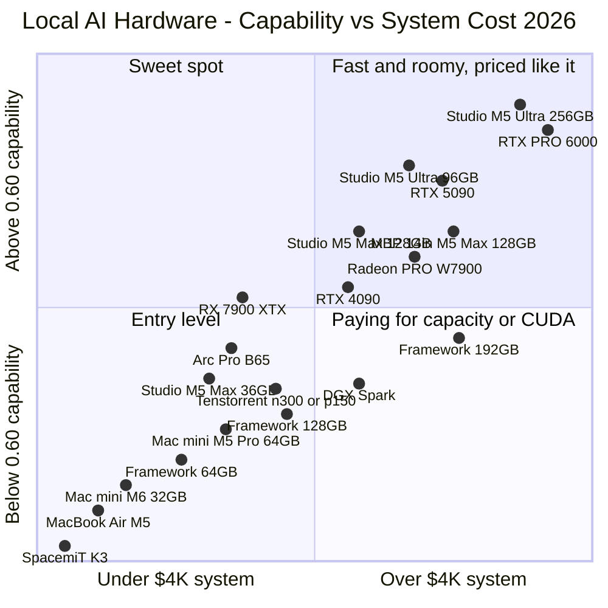

Nobody buying AI hardware in 2026 is short on opinions. The forums are full of people who swear by their setup and can't understand why anyone would choose differently. Most of those arguments are happening across completely different use cases which raises the noise floor for this subject.

<!--more-->


"What's the best hardware for running AI locally?" is roughly as useful as asking what's the best vehicle without mentioning whether you're hauling gravel or commuting to an office. The answer depends entirely on what you're trying to do, and getting that wrong is an expensive mistake.
## The three things that matter

Local AI hardware comes down to three variables: capacity, bandwidth, and software stack.

**Capacity** is whether the model fits in memory at all. If it doesn't fit, nothing else matters. You're either offloading to disk (more on that disaster in a bit) or you need a bigger box.

**Bandwidth** is how fast the hardware can feed data to the compute units. This is the single best first-pass predictor of how fast tokens actually come out. Memory bandwidth is not the same as tokens per second, but it's the cleanest way to sort real performance tiers.

**Software stack** is how much of the spec sheet you can actually cash out. A card with strong bandwidth numbers on paper does nothing useful if the inference framework doesn't support it. This is still where CUDA's dominance matters, and it's where Tenstorrent's fully open source stack is a long-term bet worth watching.

## The hardware landscape

Five distinct markets, same buzzword. Here's what each one is actually good for.

### Raw speed when the model fits: discrete GPUs

If the model fits in VRAM, discrete GPUs are still the fastest thing by a wide margin. Nothing else comes close on a per-token basis.

NVIDIA's RTX PRO 6000 Blackwell (96GB, 1792 GB/s, around \$8,000 to \$9,200 retail right now) and the RTX 5090 (32GB, 1792 GB/s, street price has been running \$3,000 to \$5,000 and climbing due to supply issues) share identical bandwidth. The difference is capacity. The PRO 6000 can hold a 70B model at Q4 comfortably and will push around 30 tok/s on it; the 5090 tops out around 30B quantized but hits 180 to 220 tok/s on 8B models where bandwidth and VRAM both cooperate. The RTX 4090 (24GB, 1008 GB/s) runs around 120 to 140 tok/s on 8B and is still worth it if you find one at a good price on the secondary market.

AMD's discrete cards deserve more credit than they typically get. The RX 7900 XTX (24GB, 960 GB/s) is competitive on bandwidth per dollar. The Radeon PRO W7900 (48GB, 864 GB/s) doubles the memory at workstation pricing. The newer AI PRO R9700 (32GB, 640 GB/s) sits in between. ROCm support has improved enough that AMD is a real option now, especially with llama.cpp and Ollama.

Intel showed up too. The Arc Pro B65 (32GB, ~608 GB/s) and B60 (24GB, ~456 GB/s) are interesting if you're following where Intel's headed with this. Not my first choice today, but they're not irrelevant.

Discrete GPUs win because they can drink from the dataplane firehose. They lose the moment the model doesn't fit and these prices don't include everything else you need to run these high performance cards.

### Biggest one-box memory: Apple Silicon

Apple's pitch is simple: not the fastest, but more unified memory in a quiet box than anything else you can buy. That pitch got a lot stronger on [August 25](https://www.apple.com/newsroom/2026/08/apple-introduces-m6-and-m5-ultra-for-a-big-leap-in-performance-and-ai-compute/), when Apple refreshed the entire Mac Studio and Mac mini line with M5 and M6 chips.

The new Mac Studio splits into M5 Max and M5 Ultra, and the gap between them just widened. The M5 Ultra starts at 96GB of unified memory at 1.2TB/s (1,229 GB/s, up from the M3 Ultra's 819 GB/s) for \$5,499 and configures up to [256GB for \$9,499](https://appleinsider.com/articles/26/08/25/mac-studio-gets-update-to-m5-max-and-m5-ultra). The 512GB tier is back too (Apple quietly pulled the M3 Ultra's 512GB option in March over the memory shortage), but it's 80-core GPU only and still listed as "late October" with no price. MacRumors expects well north of \$10,000. Even at 256GB, Apple now sells more unified memory in one box than the DGX Spark, RTX Spark, or Framework Desktop. 512GB is enough headroom for GLM-5.2 (744B MoE) at Q4, or Qwen3.5-397B and DeepSeek V4-Flash with room to spare, in a box that fits on your desk and doesn't sound like a server room.

The M5 Max Mac Studio starts at \$2,499, but read the fine print. That price gets you the 32-core GPU, about 460 GB/s, and 36GB, which won't hold a 70B Q4 model at all. The config that works for local AI is the 40-core GPU (614 GB/s, up from the M4 Max's 546) with 64GB or 128GB. A 128GB box with the 40-core GPU is \$4,699. It's been shipping since September 22. I haven't seen a good 70B benchmark yet, and a few of the numbers floating around are faster than the memory bus physically allows. The ceiling is about 15 tok/s on a 70B Q4 model, so expect around 10 in practice. If you want the top-of-line Mac Studio and don't need the CUDA stack, the M5 Ultra is the clearer pick: same silent-box premise, double the bandwidth, and capacity that used to push people toward a DGX Spark or a multi-GPU rig.

The Mac mini got the same generational split. The [M6 Mac mini](https://www.apple.com/newsroom/2026/08/apple-unveils-a-more-powerful-mac-mini-featuring-the-all-new-m6-and-m5-pro/) (16GB base, up to 32GB, 170 GB/s, from \$899) replaces the old M4 base model and lands squarely in AI PC trap territory below. The Mac mini M5 Pro (24GB base, up to 64GB, 307 GB/s, from \$1,699, or \$2,699 for 64GB) replaces the M4 Pro tier at the same bandwidth-per-dollar spot as before, just a bit faster.

The MacBook Pro M5 Max (up to 128GB, 460 to 614 GB/s, from \$4,099, or \$6,699 for a 14-inch with 128GB) and MacBook Pro M5 Pro (up to 64GB, 307 GB/s, from around \$2,200) haven't changed since March. Bloomberg says an OLED touchscreen redesign is coming around late October, still on M5 Pro and M5 Max. Same chips, so same inference numbers. Apple is also reportedly skipping M6 Pro and M6 Max entirely, so the M5 Max and M5 Ultra are what Apple has for local AI until M7 in 27.

Apple wins when you want one box, you want silence, and you want to run models that won't fit anywhere else, and that argument just got a lot easier to make. It loses when raw tokens per second and concurrency matter more than capacity.

### Coherent NVIDIA appliance: DGX Spark and RTX Spark

The DGX Spark (128GB unified, 273 GB/s) launched at \$3,999 and has since been bumped to \$4,699 due to memory supply constraints. It's not a bandwidth monster. It's a compact NVIDIA CUDA appliance with 128GB of coherent memory and NVFP4 support that hasn't fully matured yet but is interesting for the future of quantization.

NVIDIA just announced the RTX Spark at Computex 2026, and it's essentially the same architectural premise in a consumer form factor. The RTX Spark is a superchip (Grace ARM CPU with up to 20 cores, Blackwell GPU with 6,144 CUDA cores, up to 128GB unified LPDDR5X) built for Windows laptops and compact desktops, co-developed with Microsoft. OEMs including ASUS, Dell, HP, Lenovo, and Microsoft Surface are targeting fall 2026. This is the first time the full CUDA stack ships inside a thin Windows laptop, which is new even if the rest of the specs feel familiar.

The bandwidth story is the same as the DGX Spark: 273 GB/s from LPDDR5X, which puts real numbers on the table. On a 70B Q4 model, the DGX Spark decodes at around 4 to 5 tok/s. On 8B it's around 35 to 40 tok/s. A 128GB Mac Studio M5 Max (\$4,699) should do around 10 tok/s on the same 70B model, about twice as fast on the workload that actually justifies a 128GB box.

NVIDIA is also marketing the RTX Spark with a [1 petaflop of AI performance](https://nvidianews.nvidia.com/news/nvidia-microsoft-windows-pcs-agents-rtx-spark) claim, which is technically accurate the same way claiming a car "can go 150 mph" on a track under ideal conditions is technically accurate. That figure is FP4 with structured sparsity enabled, a 2x multiplier that only applies when model weights are at least 50% zeros. Most aren't. At FP16 it's closer to 250 teraflops. I've already noted the same trick for the RTX 4090 (1,321 TOPS with sparsity vs. around 660 dense) in the TOPS section below, but the RTX Spark version is more brazen because the gap is bigger and the format (FP4) is less established in real inference pipelines.

Pricing for RTX Spark consumer devices isn't confirmed yet, but premium laptops will likely land somewhere in the \$2,000 to \$3,500 range given TSMC 3nm fabrication and LPDDR5X memory costs. If that holds, an RTX Spark laptop would undercut a 128GB Mac Studio M5 Max (\$4,699) on price, but with the same memory, well under half the bandwidth, a different OS, and a CUDA dependency to justify it. The CUDA software story is real and matters to developers who need it. But if you're just running inference, the bandwidth gap follows you everywhere.

There's also the Windows on ARM compatibility question, which has a rough history. The Surface RT (2012) was a fiasco, Windows 10 ARM limped along for years with an emulation layer that was slow and incomplete, and even the first Snapdragon X Elite machines in 2024 had real gaps in driver support. The current picture is better. Windows 11's Prism emulator runs most x86 apps with around 10 to 15% overhead, and [over 93% of commonly used apps run natively](https://witechpedia.com/windows-on-arm-app-compatibility/) as of early 2026. The remaining compatibility failures are almost entirely kernel-mode drivers: anti-cheat software, some security tools, legacy hardware drivers. Jensen Huang claimed at Computex that RTX Spark will run "every Windows app ever made," which is the kind of thing a CEO says at a keynote and which the kernel-mode driver situation makes not quite true. For most users running standard productivity and developer software, the platform is fine. If you depend on specific kernel-level tooling (corporate endpoint security with no ARM64 driver, game anti-cheat, some DAW plugins), you'll want to check before buying.

NVIDIA's roadmap has Vera Rubin with LPDDR6 memory after this, which should improve the bandwidth ceiling meaningfully. The first-generation RTX Spark is an interesting platform bet, not a current-generation performance win.

Both the DGX Spark and RTX Spark are developer appliances first. Full NVIDIA stack, 128GB in a small box, not optimizing for raw decode speed. The GB10-class machines like the ASUS Ascent GX10 belong here too.

### First real x86 unified-memory contender: Strix Halo

AMD's Ryzen AI Max / Strix Halo is the most interesting new category in local AI hardware, in my opinion. Up to 128GB of LPDDR5X at ~256 GB/s, with up to ~96GB assignable as GPU memory on Windows. The Framework Desktop implements this at \$1,269 for 32GB, \$1,959 for 64GB (out of stock as I write this), and \$3,449 for the 128GB config (DIY Edition, before storage). That's up a lot from the launch pricing of \$1,099, \$1,599, and \$1,999, in line with the memory price increases hitting everyone else. Real-world decode on a Llama 70B Q4 model lands around 4 to 5 tok/s, similar to the DGX Spark and well below the Mac Studio M5 Max (much higher bandwidth ceiling). On 8B models it does around 35 to 40 tok/s, comfortable for interactive use.

It's the first mainstream x86 box where local AI starts feeling like a serious hardware class rather than a laptop pretending very hard. At \$3,449 the 128GB config isn't the steal it was at \$1,999, but it's still the cheapest gigabyte of GPU-addressable memory in this guide, and that matters most if you're running MoE models where capacity counts for more than raw bandwidth. You're paying for the ability to load the model, not for fast decode once it's loaded.

AMD didn't stop at Strix Halo. At IFA in early September, AMD detailed the [Ryzen AI Max PRO 400 series](https://www.servethehome.com/amd-reveals-ryzen-ai-max-pro-400-series-192gb-ram-for-ai-systems/) ("Gorgon Halo"), the direct successor to the chip in the Framework Desktop: up to 192GB of LPDDR5X-8533 at 273 GB/s (a modest 7% bump over Strix Halo's 256 GB/s), with up to 160GB assignable as GPU memory. AMD is marketing this as the [first x86 client chip](https://www.tomshardware.com/pc-components/cpus/amd-ryzen-ai-max-400-gorgon-halo-packs-up-to-192gb-of-unified-memory-refreshed-apu-uses-zen-5-and-rdna-3-5-and-can-clock-up-to-5-2-ghz) that can run a 300 billion parameter model locally, which is true only if you squint at "run" through the same FP4 sparsity lens I've already flagged for NVIDIA's TOPS claims elsewhere in this piece. The real number is the capacity jump: 192GB is a genuine 50% increase over Strix Halo's 128GB ceiling, and bandwidth barely moved, so expect the same 4 to 5 tok/s territory on 70B dense models, just with more room for bigger MoE models to fit at all.

The chips are shipping to OEMs in Q3 2026, which is to say essentially now, with ASUS, HP, Lenovo, and MINISFORUM all announcing systems built around the flagship Ryzen AI Max+ PRO 495. Framework's own [192GB Desktop](https://frame.work/desktop) with the Max+ PRO 495 is now up for pre-order at \$6,799 for the DIY Edition, or \$7,449 pre-built with 2TB and Fedora, shipping in November. That's nearly double the 128GB config and well past the early guesses of around \$4,500. Per gigabyte it's about the same as a Mac Studio M5 Ultra 256GB (around \$36 vs \$37), but the Ultra has 4.5x the bandwidth for about \$2,500 more. Framework's own reference setup runs DeepSeek V4.1 Flash at Q2 in 163GB on it, which tells you where the ceiling is. The board also gets an open-ended PCIe x4 slot, so you can drop in a 50Gbps RoCE NIC to cluster several of them. Buy the 192GB config for the extra headroom, not for speed.

Further out, AMD's roadmap points to a chip codenamed "Medusa Halo" built around LPDDR6, [leaked](https://www.tomshardware.com/pc-components/cpus/amds-future-medusa-halo-apus-could-use-lpddr6-ram-new-leak-suggests-ryzen-ai-max-500-series-could-have-80-percent-more-memory-bandwidth) at around 460 GB/s on a 256-bit bus, sometime in 2027 to 2028. AMD hasn't confirmed the chip exists yet, so treat that as a direction, not a spec sheet.

### The fully open source bet: Tenstorrent

Tenstorrent's Wormhole n300 (24GB, 576 GB/s, around \$1,400) and Blackhole p150 (32GB, 512 GB/s, around \$1,400 with 800G interconnect) run a fully open source stack from top to bottom. I'm rooting for this one to mature. The AI world needs more fully open stacks, and the bandwidth is competitive with mid-tier discrete GPUs. The Blackhole's interconnect makes multi-card scaling worth watching as the software ecosystem develops.

### RISC-V: SpacemiT K3

SpacemiT is a Chinese fabless semiconductor company that has been quietly building a RISC-V roadmap worth checking out. Their K1 chip shipped over 150,000 units, which is an unusually high number for RISC-V. The K3 is their follow-up, and it's a meaningful step up.

The K3 packages eight X100 RISC-V CPU cores (up to 2.4 GHz) and eight A100 AI cores into a single SoC, with RVA23 compliance (RISC-V standard), LPDDR5-6400 (low powered memory), and 60 TOPS of AI compute at INT8/FP8/FP16/BF16. For context: the K1 topped out at 2 TOPS and 16GB of LPDDR4. The K3 is a 30x jump in AI performance and doubles the max memory to 32GB.

The 60 TOPS figure comes from the A100 AI core cluster, not a discrete NPU. SpacemiT claims the platform can run a 30B-parameter model at more than 10 tokens/second. I'd wait for independent benchmarks before taking that at face value, but at least the claim is specific enough to be falsifiable. The math says it only works for a MoE model like Qwen3.6 35B-A3B (3B active per token). At ~51 GB/s, a dense 30B model tops out under 3 tok/s.

Early CPU benchmarks from CNX-Software (January 2026) show multi-core 7-Zip performance slightly better than a Rockchip RK3588, single-core slightly below a Raspberry Pi 5. Memory bandwidth (memcpy ~5,947 MB/s) is closer to Pi 5 territory than RK3588. AES-256 single-core performance lags both. Competitive general-purpose compute for a RISC-V chip, not competitive with ARM at the same price point. Not yet.

**K3-based boards coming to market**

Several boards are either shipping or in active pre-order as of May 2026:

| Board | Maker | Price | RAM | Status | Key I/O |
|---|---|---|---|---|---|
| [Jupiter 2](https://milkv.io/jupiter2) | Milk-V | \$300--\$575 | 8/16/32GB LPDDR5 | Pre-order | 10GbE SFP+, PCIe Gen3 x4, Wi-Fi 6, M.2 NVMe |
| [BPI-SM10 Dev Kit](https://forum.banana-pi.org/t/banana-pi-major-release-based-on-spacemit-k3-launching-bpi-sm10-developer-kit-and-k3-pico-itx-sbc/27238) | Banana Pi | TBD | up to 32GB LPDDR5 | Announced | Compute module format |
| [K3 Pico-ITX SBC](https://www.cnx-software.com/2026/05/11/rva23-pico-itx-sbc-spacemit-k3-octa-core-risc-v-ai-soc-up-to-32gb-ram-256gb-ufs/) | SpacemiT/Sipeed | \$299+ | up to 32GB LPDDR5 | Shipping | 10GbE, UFS up to 256GB, M.2 NVMe |
| [AIBOX-K3](https://www.cnx-software.com/2026/05/12/firefly-aibox-k3-an-edge-ai-mini-pc-powered-by-spacemit-k3-risc-v-soc/) | Firefly | \$349--\$689 | 8/32GB | Available | Industrial edge AI box, fanless |
| [DC-ROMA Mainboard III](https://deepcomputing.io/dc-roma-risc-v-mainboard-iii-unveiled-at-fosdem-powered-by-spacemit-k3-for-framework-laptop-13/) | DeepComputing | \$699--\$999 | 16/32GB LPDDR5 | Pre-order (ships June 2026) | Framework Laptop 13 drop-in mainboard |

The Milk-V Jupiter 2 is the most compelling entry point at \$300 for 8GB: Pico-ITX form factor, 10GbE SFP+, PCIe Gen3 x4, Wi-Fi 6/BT 5.2, and an aluminum enclosure with a built-in fan. The DeepComputing board is a different thing entirely. It turns a Framework Laptop 13 into a RISC-V laptop, which is either a compelling experiment or a \$699 curiosity depending on your use case. Firefly also announced the CSC2-N48SPK3, a 2U rack server with 48 K3 nodes (2,880 TOPS aggregate) starting around \$38,800. That one is squarely for researchers and the "I want a RISC-V cluster" crowd.

**Linux and inference stack**

The K3 is RVA23-compliant, which matters because Ubuntu 25.10 and later mandate RVA23. The K1 was excluded; the K3 is not. Canonical officially supports Ubuntu 26.04 LTS on K3 platforms. The kernel shipping on current hardware is 6.12.16. Initial mainline support (device tree sources under `arch/riscv/boot/dts/spacemit/`) landed in Linux 7.0, with peripheral driver expansion queued for 7.1.

RVV 1.0 is implemented with 256-bit vector registers per core. For llama.cpp specifically: SpacemiT's `bianbu` downstream fork has the best-optimized build path, since peak AI performance requires their GCC toolchain. Upstream llama.cpp has RISC-V RVV support, but expect lower throughput until the A100 AI core backend matures further.

**Who this is for**

Hobbyists, RISC-V ecosystem enthusiasts, and developers who want to build or test RISC-V-native software. If you're comparing the Jupiter 2 against a Raspberry Pi 5 or Orange Pi 5 on pure price/performance, you'll be disappointed. If you're deliberately targeting a non-ARM, non-x86 architecture (for software portability work, embedded Linux development, or just the novelty of running actual LLM inference on RISC-V hardware), the K3 is the most capable option shipping today.

### The AI PC trap

Most machines wearing an "AI PC" sticker are still bandwidth-starved in any practical sense. Snapdragon X Elite (~135 GB/s), Intel Lunar Lake (~136 GB/s), MacBook Air M5 (~153 GB/s), Snapdragon X2 Elite (~152 to 228 GB/s depending on SKU). On an 8B Q4 model you're looking at 15 to 22 tok/s, which is usable. Try to push a 13B dense model and you're dropping to 10 to 14 tok/s on most of these. Small MoE models are the exception: Qwen3.6 35B-A3B fits in 32GB and only reads 3B parameters per token, so it runs around 40 tok/s on a MacBook Air M5. Anything bigger either doesn't fit or crawls. These are fine machines for small models, personal assistants, edge workloads. They are not serious local inference hardware for anything larger than a 7 to 8B dense model. Physics still applies, which is inconvenient but consistent.

## The gimmicks section (or: technically possible doesn't mean useful)

A pattern keeps coming up in local AI discussions that costs people real time and money chasing something that doesn't work well in practice.

The pitch goes like this: "My hardware doesn't have enough memory, but I can still run a big model by only loading part of it at a time." This is usually presented as a clever hack. Sometimes it is. More often it's a performance cliff dressed up as a feature.

**Layer offloading.** Tools like llama.cpp let you split model layers between GPU VRAM, system RAM, and even disk. The flag is `-ngl` (number of GPU layers). When you don't have enough VRAM for the whole model, you offload some layers to CPU RAM. The problem is that every token generation step has to shuffle data across the PCIe bus between GPU and CPU. Real-world numbers here are brutal, people running 70B models with partial CPU offloading report around 1 to 3 tokens per second. That's technically running the model. It's also roughly the speed of reading text out loud to yourself. Not useful for interactive work.

**Disk offloading.** Some tools and frameworks support streaming model weights from NVMe directly. Modern NVMe drives can hit 7 GB/s reads in ideal conditions, which sounds fast until you realize your GPU memory bandwidth is 10 to 100x that. The energy penalty alone is significant, recent research puts SSD-offloaded decode at roughly 3 to 4x the energy cost versus in-memory inference on comparable hardware. Token generation with disk offload in practice tends to land below 1 token per second. I've seen people run 405B models this way. I've also seen them wait two minutes for a 60-token response.

**Extreme quantization.** Q4 is excellent, Q5 and Q8 are great when you can afford the memory for them. The cliff is at the bottom. Q2 quantization degrades quality enough that for many use cases you'd be better off running a smaller, better-quantized model. A Q2 70B model (~25GB) often does worse than a Q4 32B (~19GB) on reasoning tasks while using more memory.

**The 30 tokens-per-second floor.** For interactive use, actual back-and-forth conversation or coding assistance where you're watching the output stream, 30 tok/s is roughly where it starts feeling like a tool rather than a waiting exercise. Below 15 tok/s it becomes noticeable. Below 5 tok/s it's painful regardless of model quality. For batch processing or background tasks, slower is tolerable. But if you're evaluating a hardware setup for daily driving, "it runs" and "it's usable" are different things.

The test I'd apply: if your setup produces tokens slower than you read them, you're probably past the gimmick threshold for interactive use.

## What models are you actually trying to run?

Hardware decisions only make sense relative to the models you're targeting. Open source models in 2026 have gotten good, close enough to frontier API models on many tasks that the conversation has shifted from "is open source good enough?" to "which open source model is right for this?"

The big architectural shift is MoE (Mixture of Experts). These models have enormous total parameter counts but only activate a fraction of them per token. That changes the capacity-vs-speed tradeoff dramatically. DeepSeek V4-Flash needs about 170GB to load but only reads 13B parameters' worth of weights per token, so once it fits, it decodes like a 13B model. That's why big-memory, modest-bandwidth boxes like the DGX Spark and Framework Desktop got a lot more useful this year.

Speeds below are estimates: memory bandwidth ÷ the bytes read per token, discounted to what real setups typically hit (roughly 70% for dense models, 50% for MoE). Most of these pairings haven't been benchmarked yet. Sizes assume Q4_K_M at about 0.6GB per billion parameters.

**24 to 32GB (RTX 5090, RX 7900 XTX, Arc Pro B65, Mac mini M6, MacBook Air M5 max):** The sweet spot here is small MoE models, which load like a 30B model but decode like a 3B one. Qwen3.6 35B-A3B (~21GB at Q4) is tight but workable on a 24GB card. Gemma 4 26B MoE (~16GB at Q4, 4B active) does 85+ tok/s on a discrete GPU and around 30 on a MacBook Air. Qwen3-Coder 30B-A3B (~18GB) is the coding pick. If you want a dense model, Qwen3.8 27B (August, ~16GB at Q4) is the newest option, and Phi-4-reasoning-vision 15B (~9GB) covers reasoning with image input in less. Useful territory, not the frontier.

**48 to 64GB (Mac Studio M5 Max, Mac mini M5 Pro, MacBook Pro M5 Pro, Framework Desktop 64GB):** Dense 30 to 40B models at Q4 land comfortably here, and the 24 to 32GB models move up to Q8 (Qwen3.6 35B-A3B is ~37GB at Q8), which is a real quality bump for not much speed. One catch on Macs: macOS only lets the GPU use about 75% of unified memory by default, so a 64GB machine has roughly 48GB to work with unless you raise the limit (`sudo sysctl iogpu.wired_limit_mb`). Llama 4 Scout (~65GB at Q4) needs the next tier up. This is where local AI starts feeling like a real tool rather than an experiment.

**96GB (Mac Studio M5 Ultra base config, RTX PRO 6000, DGX Spark + 128GB configs):** This is where the 100B-class MoE models live: GPT-OSS-120B (~62GB, still OpenAI's latest open model), Mistral Small 4 (119B total, 6.5B active, ~71GB at Q4), Qwen3.5-122B-A10B (~73GB), and Llama 4 Scout (~65GB). Because so few parameters are active per token, they run fast even on modest bandwidth. GPT-OSS-120B does around 35 to 45 tok/s on a DGX Spark, and Qwen3.5-122B lands around 20 to 25 there versus 70 to 100 on an M5 Ultra. On a 96GB Mac the default GPU limit is about 72GB, so the two 70GB-plus models need the limit raised. It's the entry point for the M5 Ultra.

**128GB+ (Mac Studio M5 Ultra, Framework Desktop 192GB, multi-GPU rigs, DGX Spark):** This tier changed shape in August. The Mac Studio M5 Ultra now goes to 256GB (shipping now, \$9,499) and 512GB (arriving late October, price TBD), which puts Apple ahead of everything else in this guide on raw capacity, DGX Spark and the new 192GB Framework Desktop included. DeepSeek V4-Flash (284B total, 13B active) is the model that defines this tier. It's about 170GB at Q4, so it fits a 256GB Ultra and runs around 60 to 80 tok/s there; the 192GB Framework (160GB GPU-assignable) needs Q3 or lower (Framework's own reference runs V4.1 Flash at Q2) and lands closer to 15 to 20. Qwen3.5-397B-A17B is ~238GB at Q4, which means Q3 on a 256GB box or Q4 on the 512GB one, at around 50 tok/s on an Ultra. The 512GB Ultra is also the only single box here that holds GLM-5.2 (744B, 40B active, ~446GB at Q4 with the GPU memory limit raised), at roughly 25 tok/s. DeepSeek V4-Pro (1.6T) needs ~960GB at Q4, which is multi-box territory. Llama 4 Maverick (~240GB at Q4) still fits the big Ultras, but with Meta moving to the closed Muse Spark in April, it's the end of the Llama line, not a starting point. Multi-GPU NVIDIA setups still win on raw throughput if you need to serve several users at once, but for a single person running the biggest open models locally, the M5 Ultra is now the path of least resistance.

## The quadrant chart

Here's how these platforms map when you combine memory capacity, bandwidth, and cost into a single picture. The vertical axis is a bandwidth-weighted capability score and the horizontal axis is total system cost, GPU cards included with a host PC. The lines sit at \$4,000 and a score of 0.60, about where a box can run a 70B model at a usable speed, and each side is stretched so the crowded middle stays readable. Position shows rank, not distance. The real numbers are in the table below.



<details>
<summary>How the capability score is calculated + data table</summary>

The score combines memory capacity (GB) and memory bandwidth (GB/s). Neither alone tells the full story. Bandwidth sets how fast tokens come out once a model is loaded; capacity decides which models load at all. So this is a capability score, not a tok/s number. For that, see the 70B column in the table.

**Scoring method:**

Both dimensions are on a log2 scale with fixed anchors, so adding a new box doesn't reshuffle everybody else's score. Model sizes step up in roughly doublings, so going from 24 to 48GB matters a lot more than going from 192 to 216GB, and the log scale reflects that. Bandwidth is weighted 65%, capacity 35%.

```
capacity_score  = log2(GB / 8)    / log2(512 / 8)      # clamped 0..1
bandwidth_score = log2(GB_s / 50) / log2(2000 / 50)
capability      = 0.35 * capacity_score + 0.65 * bandwidth_score
```

**Cost axis:** total system cost. Discrete GPUs get about \$2,000 added for the host PC they need, since a card on its own isn't a working computer. Apple prices are from apple.com as of October 12, cheapest config at each memory size. Framework prices are from frame.work as of October 13: the DIY Edition plus its cheapest 500GB SSD. Street price midpoints elsewhere.

**Chart layout:** Mermaid always draws its quadrant lines through the middle, so the coordinates are remapped (piecewise linear) to put the lines at \$4,000 and a score of 0.60. Order is preserved but distances aren't to scale. A few near-ties are nudged slightly so labels don't collide, and the two Tenstorrent cards share a point.

**70B Q4 ceiling:** memory bandwidth ÷ ~42GB (a 70B Q4_K_M model), the hard upper limit on single-stream decode. Real-world numbers land at roughly 65 to 75% of that. "Doesn't fit" uses macOS's default ~75% GPU memory limit on Macs.

| Platform | Memory (GB) | Bandwidth (GB/s) | Cap Score | BW Score | Capability | System Cost (\$) | 70B Q4 ceiling (tok/s) |
|---|---|---|---|---|---|---|---|
| Mac Studio M5 Ultra 256GB | 256 | 1229 | 0.83 | 0.87 | 0.86 | 9,499 | 29 |
| RTX PRO 6000 | 96 | 1792 | 0.60 | 0.97 | 0.84 | 10,500 | 43 |
| Mac Studio M5 Ultra 96GB | 96 | 1229 | 0.60 | 0.87 | 0.77 | 5,499 | 29 |
| RTX 5090 | 32 | 1792 | 0.33 | 0.97 | 0.75 | 6,200 | doesn't fit |
| Mac Studio M5 Max 128GB | 128 | 614 | 0.67 | 0.68 | 0.68 | 4,699 | 15 |
| MacBook Pro 14" M5 Max 128GB | 128 | 614 | 0.67 | 0.68 | 0.68 | 6,699 | 15 |
| Radeon PRO W7900 | 48 | 864 | 0.43 | 0.77 | 0.65 | 5,600 | 21 |
| RTX 4090 | 24 | 1008 | 0.26 | 0.81 | 0.62 | 4,500 | doesn't fit |
| RX 7900 XTX | 24 | 960 | 0.26 | 0.80 | 0.61 | 2,950 | doesn't fit |
| Framework 192GB | 192 | 273 | 0.76 | 0.46 | 0.57 | 6,934 | 6 |
| Arc Pro B65 | 32 | 608 | 0.33 | 0.68 | 0.56 | 2,750 | doesn't fit |
| DGX Spark | 128 | 273 | 0.67 | 0.46 | 0.53 | 4,699 | 6 |
| TT Blackhole p150 | 32 | 512 | 0.33 | 0.63 | 0.53 | 3,400 | doesn't fit |
| TT Wormhole n300 | 24 | 576 | 0.26 | 0.66 | 0.52 | 3,400 | doesn't fit |
| Framework 128GB | 128 | 256 | 0.67 | 0.44 | 0.52 | 3,584 | 6 |
| Mac Studio M5 Max 36GB | 36 | 460 | 0.36 | 0.60 | 0.52 | 2,499 | doesn't fit |
| Mac mini M5 Pro 64GB | 64 | 307 | 0.50 | 0.49 | 0.49 | 2,699 | 7 |
| Framework 64GB | 64 | 256 | 0.50 | 0.44 | 0.46 | 2,094 | 6 |
| Mac mini M6 32GB | 32 | 170 | 0.33 | 0.33 | 0.33 | 1,299 | doesn't fit |
| MacBook Air M5 32GB | 32 | 153 | 0.33 | 0.30 | 0.31 | 1,100 | doesn't fit |
| SpacemiT K3 Pico-ITX (8GB) | 8 | ~51† | 0.00 | 0.01 | 0.00 | 299 | doesn't fit |

The 512GB Mac Studio M5 Ultra isn't plotted until Apple prices it. When it is, it lands around 0.91, and because the anchors are fixed, nothing else on the chart moves.

†SpacemiT K3 LPDDR5-6400 theoretical peak bandwidth is ~51 GB/s on a 32-bit bus. It belongs in a different tier entirely. See the RISC-V section above for context on what these boards are actually for.

</details>


A few things jump out. The top-left sweet spot is nearly empty: the RX 7900 XTX is the only thing in it, and it's still the cheapest bandwidth you can buy if 24GB is enough, even after you count the PC it lives in. The Mac Studio M5 Ultra 256GB is the top scorer, and the 96GB Ultra at \$5,499 edges out an RTX 5090 build once the host PC is counted. The M5 Max Studio and MacBook Pro score identically, but the laptop costs \$2,000 more for the privilege. The Framework 128GB is still the cheapest gigabyte in the field, but at \$3,584 with storage, its lead is a lot narrower than it was at \$1,999. The 192GB model lands in the bottom-right quadrant at nearly double that, right next to a DGX Spark it doesn't beat on bandwidth. The DGX Spark is still the chart's anomaly: high capacity, middling bandwidth, high cost, and a software stack that might eventually justify all of it.

## Understanding TOPS

Every AI chip ships with a TOPS number. TOPS stands for Tera Operations Per Second (one trillion integer operations per second). It sounds like a clean unit, and it is, as far as it goes.

The problems start when you try to compare TOPS numbers across vendors.

TOPS is almost always measured at INT8 precision, 8-bit integer arithmetic. INT8 is common in quantized inference because it's faster and cheaper than FP32, and accuracy loss is usually acceptable. But vendors quote peak theoretical TOPS under ideal conditions: perfectly parallelized workloads, full hardware utilization, no memory stalls, supported operators only.

Real LLM inference rarely hits that ceiling. Memory bandwidth is usually the bottleneck, not compute. A large language model spends most of its time moving weights between memory and compute units, and if those weights don't fit in fast on-chip memory (they usually don't), you're waiting on DRAM bandwidth regardless of how fast the arithmetic units are.

There's also a precision equivalence problem. Apple quotes its Neural Engine at 38 TOPS for the M4, but that figure comes from counting INT8 operations as 2x the FP16 rate. That's industry convention, not necessarily hardware reality. The ANE dequantizes INT8 weights to FP16 before compute, so the 2x multiplier is partly accounting. A 38 TOPS ANE and a 38 TOPS NPU from a different vendor are not the same thing.

The bigger issue is software maturity. A 2 TOPS NPU with mature, optimized software will outperform a 26 TOPS NPU with poor framework support for most real-world workloads. Apple's Neural Engine is the clearest example: Core ML and the ANE runtime are deeply co-designed, operator coverage is comprehensive, and the toolchain handles quantization automatically. A Hailo-8 at 26 TOPS needs Hailo's SDK and specific model conversion, operator coverage gaps are real and documented. For RISC-V platforms like the K3, the AI core stack is still maturing. The hardware headroom is there, but the software to actually cash out 60 TOPS on arbitrary LLM workloads isn't yet at Apple's or NVIDIA's level.

**Cross-platform TOPS comparison**

| Platform | TOPS | Precision | Scope | Notes |
|---|---|---|---|---|
| SpacemiT K1 | 2 | INT8 | AI cores | 8-core RISC-V, K3 predecessor |
| SpacemiT K3 | 60 | INT4/INT8/FP8/FP16/BF16 | 8 A100 AI cores | RVA23 RISC-V; software stack still maturing |
| Hailo-8L | 13 | INT8 | Dedicated NPU | Used in Raspberry Pi AI HAT+ |
| Hailo-8 | 26 | INT8 | Dedicated NPU | M.2 accelerator; ~2.5W; SDK-dependent |
| Apple M3 Neural Engine | 18 | FP16 | NPU only | 16-core ANE; mature Core ML stack |
| Apple M3 Ultra Neural Engine | ~36 | FP16 | NPU only | 32-core ANE (2x M3 die); estimated |
| Apple M4 Neural Engine | 38 | INT8 (conv.) | NPU only | Per Apple; INT8 to FP16 dequant in practice |
| Apple M5 Neural Engine | n/a | n/a | NPU only | Apple stopped disclosing an absolute TOPS figure starting with M5; still 16 cores, marketed as "faster" with no number given |
| Apple M6 Neural Engine | n/a | n/a | NPU only | Dual 16-core (new); Apple claims "2x faster" than the previous generation, again with no absolute figure |
| Intel Core Ultra (Lunar Lake) | ~47 | INT8 | NPU only | Core Ultra 9 288V; Copilot+ certified |
| Qualcomm Snapdragon X Elite | 45 | INT8 | NPU only | Hexagon NPU; Windows on ARM |
| Qualcomm Snapdragon X2 Elite | 80 | INT8 | NPU only | Latest gen (2025); 78% jump over X Elite |
| AMD Ryzen AI Max+ 395 (Strix Halo) | 50 | INT8 | XDNA2 NPU only | 126 TOPS is AMD's combined CPU+GPU+NPU platform figure; the NPU alone is the comparable number here |
| AMD Ryzen AI Max+ PRO 495 (Gorgon Halo) | 55 | INT8 | XDNA2 NPU only | Only a 10% bump over Strix Halo's NPU; this generation's real pitch is memory, not compute |
| Tenstorrent Wormhole n150 | ~262 TFLOPs | FP8 | Full chip | Not a traditional TOPS figure; 72 Tensix cores |
| Tenstorrent Wormhole n300 | ~524 TFLOPs | FP8 | Full chip (dual die) | Two Wormhole dies; a straight doubling of the n150 per Tenstorrent's own numbers |
| Tenstorrent Blackhole p150 | 664 TFLOPs | BLOCKFP8 | Full chip | Newer architecture than Wormhole; also not a traditional TOPS figure |
| NVIDIA RTX 4090 | 1,321 | INT8 w/ sparsity | GPU tensor | Includes structured sparsity 2x multiplier |
| NVIDIA RTX 5090 | ~3,352 | INT8 w/ sparsity | GPU tensor | With sparsity; ~1,677 TOPS dense |
| NVIDIA RTX PRO 6000 Blackwell | 4,000 | FP4 w/ sparsity | GPU tensor | Same sparsity/precision trick as the RTX 4090 and 5090, just a much bigger headline number |
| NVIDIA GB10 (DGX Spark / RTX Spark) | 1,000 | FP4 w/ sparsity | Full SoC | NVIDIA's own "1 petaflop" claim, already flagged elsewhere in this piece |
| AMD Radeon PRO W7900 | 245 (INT4) / 123 (INT8) | INT4 / INT8 | GPU matrix | AMD's own published figures; no sparsity multiplier involved |
| AMD Radeon AI PRO R9700 | 1,531 (INT4 sparse) / 383 (INT8) | INT4 / INT8 | GPU matrix | AMD claims 4x the TOPS of the outgoing Radeon PRO W7800 |
| Intel Arc Pro B60 / B65 | 197 | INT8 XMX, dense | GPU matrix | Both cards report identical peak TOPS despite different memory configs |

A few things worth calling out: the RTX 4090's 1,321 TOPS includes structured sparsity, a 2x multiplier that only applies when model weights are 50% or more zero. Most aren't. NVIDIA's dense INT8 is closer to 660 TOPS. The RTX PRO 6000 and the GB10 chip inside the DGX Spark and RTX Spark play the same game at a bigger scale, 4,000 TOPS and 1,000 TOPS respectively, both quoted at FP4 with sparsity, both numbers I've already leaned on skeptically elsewhere in this piece. The Tenstorrent Wormhole and Blackhole chips report FP8 or BLOCKFP8 TFLOPs rather than TOPS entirely, which reflects a different architectural philosophy, not an attempt to dodge comparison. The SpacemiT K3's 60 TOPS is dependent on a software stack that's still being built. Apple, meanwhile, quietly stopped publishing a Neural Engine TOPS figure at all starting with the M5. It's still 16 cores, same as M4, so a flat number would have read as no progress; the marketing moved to comparative claims about the GPU's new Neural Accelerators instead ("4x M4" for AI compute), a framing with no absolute number for anyone to hold up against Apple's own next chip. AMD's NPU took the opposite path this generation: the Ryzen AI Max PRO 400's NPU only ticked up from 50 to 55 TOPS over Strix Halo, which is why Gorgon Halo's real pitch is memory capacity, not compute. And AMD doesn't publish a TOPS figure at all for plain RDNA3 cards like the RX 7900 XTX, only for the "AI PRO" branded W7900 and R9700, which says something about which of AMD's cards TOPS was ever meant to sell.

Raw TOPS is a starting point, not an answer. Match the platform to the workload, check framework support for your model architecture, and benchmark before committing.

## Which bottleneck are you buying?

Stop asking which hardware is best. Start asking which bottleneck you're willing to pay to solve.

If you're doing multi-agent workflows where you need fast concurrent inference, with multiple agents running in parallel each waiting on responses, bandwidth wins and you want discrete NVIDIA. If you're running a single large reasoning model for deep analysis or long-context work, capacity wins and you want unified memory. If you're experimenting and want the best flexibility per dollar, a 64GB Mac mini M5 Pro (\$2,699) or a 128GB Framework Desktop (\$3,449) are hard to beat as starting points.

The local AI hardware market in 2026 is finally interesting enough that there's no single right answer, which means the space has matured past the point where CUDA was the only viable path and a \$10,000 GPU was the only serious option.

## Sources and where to buy

### Primary references

- [NVIDIA RTX PRO 6000 Blackwell](https://www.nvidia.com/en-us/design-visualization/rtx-pro-6000/)
- [NVIDIA RTX 5090](https://www.nvidia.com/en-us/geforce/graphics-cards/50-series/rtx-5090/)
- [NVIDIA DGX Spark](https://www.nvidia.com/en-us/products/workstations/dgx-spark/)
- [NVIDIA RTX Spark](https://www.nvidia.com/en-us/products/rtx-spark/)
- [NVIDIA RTX Spark announcement](https://nvidianews.nvidia.com/news/nvidia-microsoft-windows-pcs-agents-rtx-spark)
- [Apple Mac Studio](https://www.apple.com/mac-studio/)
- [Apple MacBook Pro](https://www.apple.com/macbook-pro/)
- [Apple Mac mini](https://www.apple.com/mac-mini/)
- [Apple Mac Studio M5 Ultra announcement](https://www.apple.com/newsroom/2026/08/apple-introduces-m6-and-m5-ultra-for-a-big-leap-in-performance-and-ai-compute/)
- [Apple Mac Studio and Mac mini availability (Sept 22)](https://www.apple.com/newsroom/2026/09/the-new-mac-mini-and-mac-studio-are-available-today/)
- [Apple Mac mini M6 and M5 Pro announcement](https://www.apple.com/newsroom/2026/08/apple-unveils-a-more-powerful-mac-mini-featuring-the-all-new-m6-and-m5-pro/)
- [AMD Ryzen AI Max (Strix Halo)](https://www.amd.com/en/products/processors/laptop/ryzen/ryzen-ai-max.html)
- [AMD Ryzen AI Max PRO 400 series announcement](https://www.amd.com/en/blogs/2026/amd-powers-next-generation-agent-computers-with-new-ryzen-ai-hal.html)
- [Ryzen AI Max PRO 400 "Gorgon Halo" specs (Tom's Hardware)](https://www.tomshardware.com/pc-components/cpus/amd-ryzen-ai-max-400-gorgon-halo-packs-up-to-192gb-of-unified-memory-refreshed-apu-uses-zen-5-and-rdna-3-5-and-can-clock-up-to-5-2-ghz)
- [AMD Medusa Halo LPDDR6 leak (Tom's Hardware)](https://www.tomshardware.com/pc-components/cpus/amds-future-medusa-halo-apus-could-use-lpddr6-ram-new-leak-suggests-ryzen-ai-max-500-series-could-have-80-percent-more-memory-bandwidth)
- [Framework Desktop](https://frame.work/desktop)
- [AMD Radeon PRO W7900](https://www.amd.com/en/products/graphics/workstations/radeon-pro/w7900.html)
- [AMD Radeon AI PRO R9700](https://www.amd.com/en/products/graphics/workstations/radeon-pro/radeon-ai-pro-r9700.html)
- [Intel Arc Pro B-Series](https://www.intel.com/content/www/us/en/products/docs/discrete-gpus/arc/workstation/pro-b-series.html)
- [Tenstorrent Blackhole](https://tenstorrent.com/en/hardware/blackhole)
- [Tenstorrent Wormhole](https://tenstorrent.com/en/hardware/wormhole)
- [SpacemiT K3 specs brief](https://cdn-resource.spacemit.com/file/chip/K3/K3_brief_en.pdf)
- [SpacemiT K3 early benchmarks (CNX Software)](https://www.cnx-software.com/2026/01/23/spacemit-k3-16-core-risc-v-soc-system-information-and-early-benchmarks/)
- [K3 Pico-ITX SBC (CNX Software)](https://www.cnx-software.com/2026/05/11/rva23-pico-itx-sbc-spacemit-k3-octa-core-risc-v-ai-soc-up-to-32gb-ram-256gb-ufs/)
- [Firefly AIBOX-K3 (CNX Software)](https://www.cnx-software.com/2026/05/12/firefly-aibox-k3-an-edge-ai-mini-pc-powered-by-spacemit-k3-risc-v-soc/)
- [DeepComputing DC-ROMA III (CNX Software)](https://www.cnx-software.com/2026/05/13/spacemit-k3-powered-dc-roma-risc-v-motherboard-iii-is-made-for-the-framework-laptop-13/)
- [Canonical Ubuntu on K3/K1](https://canonical.com/blog/spacemit-announces-availability-of-ubuntu-on-k3-k1-series)
- [Meta Llama 4](https://ai.meta.com/blog/llama-4-multimodal-intelligence/)
- [Qwen3.8 (QwenLM GitHub)](https://github.com/QwenLM/Qwen3.8)
- [Gemma 4 model overview](https://ai.google.dev/gemma/docs/core)
- [DeepSeek V4 Pro and Flash (Artificial Analysis)](https://artificialanalysis.ai/articles/deepseek-is-back-among-the-leading-open-weights-models-with-v4-pro-and-v4-flash)
- [Meta Muse Spark (The Register)](https://www.theregister.com/2026/04/08/meta_muse_spark/)
- [NVIDIA on Llama 4 inference](https://developer.nvidia.com/blog/nvidia-accelerates-inference-on-meta-llama-4-scout-and-maverick/)
- [RTX PRO 6000 pricing detail](https://www.thundercompute.com/blog/nvidia-rtx-pro-6000-pricing)
- [DGX Spark price change](https://forums.developer.nvidia.com/t/2-23-2026-price-change-announcement/361713)

### Where to buy

- **NVIDIA RTX 5090** -- [Best Buy](https://www.bestbuy.com/site/searchpage.jsp?st=RTX+5090), [Newegg](https://www.newegg.com/p/N82E16814133983), [B&H Photo](https://www.bhphotovideo.com/c/product/1798852-REG) (stock is spotty, prices above MSRP)
- **NVIDIA RTX PRO 6000 Blackwell** -- [Newegg](https://www.newegg.com/p/1FT-000S-003H5), [Amazon RTX PRO 6000](https://www.amazon.com/s?k=RTX+PRO+6000+Blackwell), [Micro Center](https://www.microcenter.com/search/search_results.aspx?Ntt=RTX+PRO+6000), [B&H Photo RTX PRO 6000](https://www.bhphotovideo.com/c/search?q=RTX+PRO+6000&sort=PRICE_LOW_TO_HIGH)
- **RTX 4090** -- secondary market, [eBay RTX 4090](https://www.ebay.com/sch/i.html?_nkw=RTX+4090+GPU), [Newegg used](https://www.newegg.com/p/N82E16814133937)
- **Apple Mac Studio** -- [Mac Studio M5 Max (up to 128GB)](https://www.apple.com/shop/buy-mac/mac-studio), [Mac Studio M5 Ultra (up to 512GB)](https://www.apple.com/shop/buy-mac/mac-studio)
- **Apple MacBook Pro** -- [MacBook Pro 16" M5 Max 128GB](https://www.apple.com/shop/buy-mac/macbook-pro)
- **Apple Mac mini** -- [Mac mini M6 and M5 Pro config selector](https://www.apple.com/shop/buy-mac/mac-mini)
- **Apple MacBook Air** -- [MacBook Air M5 configs](https://www.apple.com/shop/buy-mac/macbook-air)
- **NVIDIA DGX Spark** -- [NVIDIA Marketplace direct](https://marketplace.nvidia.com/en-us/enterprise/personal-ai-supercomputers/dgx-spark/) (enterprise ordering)
- **ASUS Ascent GX10** -- [ASUS store](https://www.asus.com/us/commercial-servers/asus-ascent-gx10/) (system integrator quotes)
- **Framework Desktop** -- [Framework order page](https://frame.work/desktop) (32GB \$1,269, 64GB \$1,959, 128GB \$3,449; 192GB Max+ PRO 495 on pre-order at \$6,799 DIY or \$7,449 pre-built, shipping November)
- **AMD RX 7900 XTX** -- [Newegg RX 7900 XTX](https://www.newegg.com/p/N82E16814161643), [Amazon RX 7900 XTX](https://www.amazon.com/s?k=RX+7900+XTX), [B&H Photo RX 7900 XTX](https://www.bhphotovideo.com/c/search?q=RX+7900+XTX)
- **AMD Radeon PRO W7900** -- [AMD.com Radeon PRO](https://www.amd.com/en/products/graphics/workstations/radeon-pro/w7900.html), [CDW PRO W7900](https://www.cdw.com/search/?searchscope=all&keyword=Radeon+PRO+W7900), [B&H Photo PRO W7900](https://www.bhphotovideo.com/c/search?q=Radeon+PRO+W7900)
- **AMD Radeon AI PRO R9700** -- [AMD.com AI PRO](https://www.amd.com/en/products/graphics/workstations/radeon-pro/radeon-ai-pro-r9700.html), [CDW R9700](https://www.cdw.com/search/?searchscope=all&keyword=Radeon+AI+PRO+R9700)
- **Intel Arc Pro B65** -- [Intel Arc Pro B-series](https://www.intel.com/content/www/us/en/ark/products/code/244396/intel-arc-pro-b65.html), [CDW Arc Pro B65](https://www.cdw.com/search/?searchscope=all&keyword=Intel+Arc+Pro+B65)
- **Tenstorrent Wormhole / Blackhole** -- [Tenstorrent store](https://tenstorrent.com/en/store) (direct ordering)
